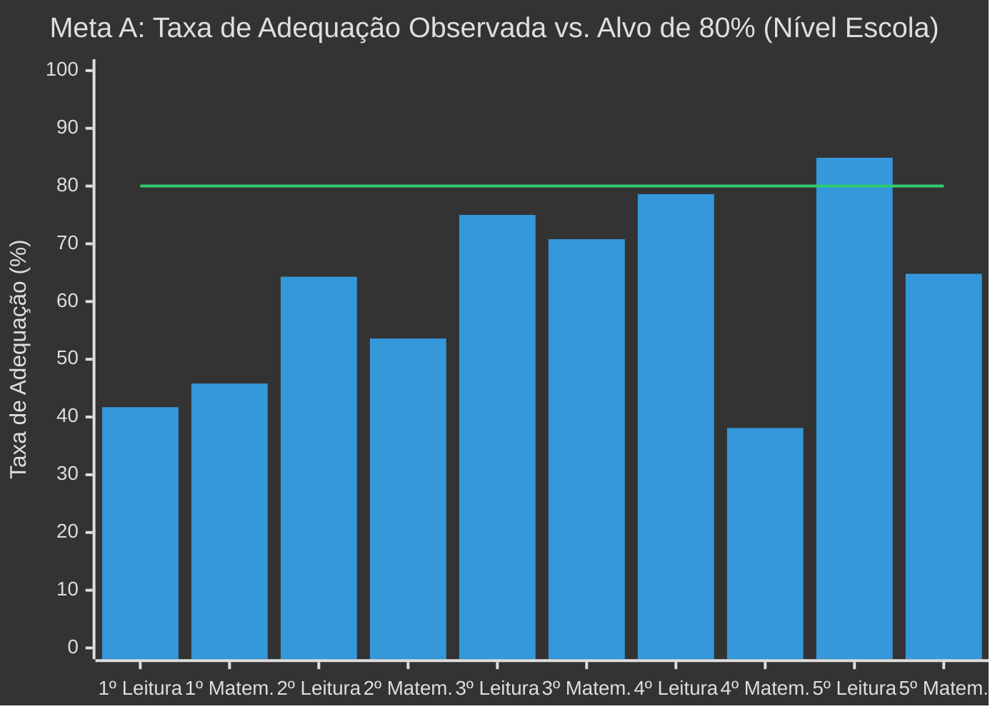
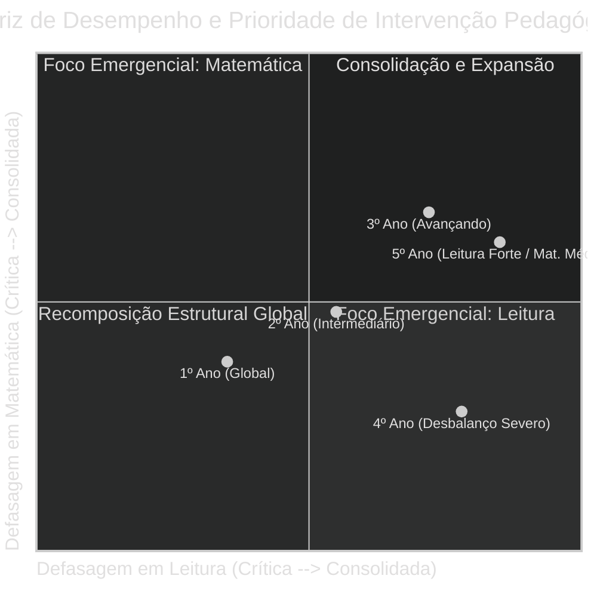
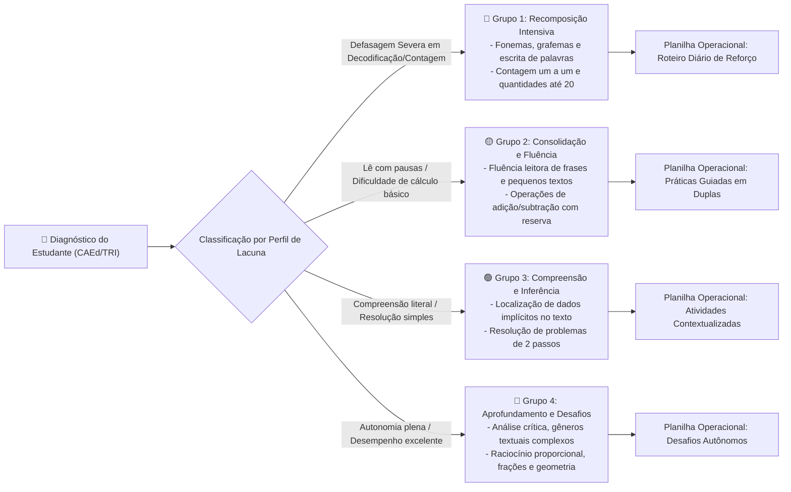

# Projeto Airam Veras — Diagnóstico, Intervenção e Mineração de Dados Educacionais 2026

Repositório unificado com todos os recursos, dados de avaliação, matrizes curriculares, ferramentas pedagógicas e pipeline de engenharia analítica do **Projeto Airam Veras**.

---

## 🗺️ Mapa Navegável da Estrutura do Repositório (Mermaid Dinâmico)

O diagrama abaixo ilustra a arquitetura completa do projeto. **Cada nó do diagrama é interativo e navegável**: clique diretamente nos blocos para inspecionar os diretórios e arquivos no repositório.

```mermaid
graph TD
    %% Estilos e Classes
    classDef rootBox fill:#1e293b,stroke:#3b82f6,stroke-width:2px,color:#ffffff,font-weight:bold;
    classDef dataBox fill:#0f172a,stroke:#10b981,stroke-width:2px,color:#ffffff;
    classDef pipelineBox fill:#1e1b4b,stroke:#8b5cf6,stroke-width:2px,color:#ffffff;
    classDef docBox fill:#1f2937,stroke:#f59e0b,stroke-width:2px,color:#ffffff;
    classDef reportBox fill:#1c1917,stroke:#ec4899,stroke-width:2px,color:#ffffff;

    AIRAM["🏫 Airam Veras (Raiz do Projeto)"]:::rootBox

    subgraph SEC_GOV ["🏛️ Governança, Fontes e Relatórios Históricos"]
        ORG["📁 00_ORGANIZACAO"]:::docBox
        ORG_FONTES["📄 01_Fontes_atuais (Zips e CSVs)"]:::dataBox
        ORG_BANCO["📊 02_Dados_e_banco (Dataset Consolidado)"]:::dataBox
        ORG_ANALISE["📈 03_Analises (Curriculo e Cruzamentos)"]:::docBox
        ORG_RELAT["📑 04_Relatorios (Painéis Executivos)"]:::reportBox
        ORG --> ORG_FONTES & ORG_BANCO & ORG_ANALISE & ORG_RELAT
    end

    subgraph SEC_CURR ["📚 Inteligência Curricular e Matrizes"]
        BNCC_DADOS["📁 bncc-dados (Matrizes 2018/2022)"]:::dataBox
        BNCC_TOOLS["🛠️ bncc-ferramentas (MCP e Utilitários)"]:::pipelineBox
        SPAECE["🏛️ spaece-dados (Escala Histórica Estadual)"]:::dataBox
        PDF_MEC["📜 MEC_2026_CNCA_Matriz_Defeso.pdf"]:::docBox
    end

    subgraph SEC_EVAL ["📝 Avaliações Diagnósticas e Resultados"]
        CAED_RAW["📁 caed-dados (Cadernos e Microdados)"]:::dataBox
        RES_CAED["📁 resultados-caed-ciclo-i-2026 (Ciclo I 1º ao 5º)"]:::dataBox
        RES_SAAP["📁 resultados-saap-ciclo-i-2026 (Resultados SAAP)"]:::dataBox
        COLAB_1ANO["📁 CAEd_Colab_PACOTE-1ANO (Rotinas Iniciais)"]:::docBox
    end

    subgraph SEC_ENGINE ["⚙️ datamining: Pipeline Analítico, Estatística e Testes"]
        DM_ROOT["📁 datamining"]:::pipelineBox
        DM_CURR["🧬 curriculo/ (Mapeador CAEd x BNCC)"]:::pipelineBox
        DM_STATS["📐 estatistica/ (TRI, Rasch e TCT)"]:::pipelineBox
        DM_REPORTS["📊 reports/ (Builder XLSX Oficial e HTML)"]:::reportBox
        DM_TESTS["🧪 tests/ (360+ Testes TDD T01–T11)"]:::pipelineBox
        DM_EVID["🛡️ evidencias/ (Contraprova e Recibos Auditáveis)"]:::docBox
        DM_REST["🔒 restrito/ (Saídas e Intervenção Nominal)"]:::dataBox
        DM_ROOT --> DM_CURR & DM_STATS & DM_REPORTS & DM_TESTS & DM_EVID & DM_REST
    end

    subgraph SEC_SPEC ["📋 Arquitetura SDD e Contratos"]
        DOCS["📁 docs/ (Especificações Técnicas e Planos)"]:::docBox
        CODEX["🤖 .codex/ (Agentes de Mineração e Auditoria)"]:::pipelineBox
    end

    AIRAM --> SEC_GOV
    AIRAM --> SEC_CURR
    AIRAM --> SEC_EVAL
    AIRAM --> SEC_ENGINE
    AIRAM --> SEC_SPEC

    %% Links Navegáveis (Clique para abrir)
    click ORG href "00_ORGANIZACAO" "Explorar pasta 00_ORGANIZACAO"
    click BNCC_DADOS href "bncc-dados" "Explorar matrizes e schemas BNCC"
    click BNCC_TOOLS href "bncc-ferramentas" "Explorar ferramentas e MCP da BNCC"
    click CAED_RAW href "caed-dados" "Inspecionar microdados e cadernos CAEd"
    click RES_CAED href "resultados-caed-ciclo-i-2026" "Ver resultados do Ciclo I CAEd"
    click RES_SAAP href "resultados-saap-ciclo-i-2026" "Ver resultados SAAP"
    click SPAECE href "spaece-dados" "Ver histórico e descritores do SPAECE"
    click DM_ROOT href "datamining" "Explorar código do pipeline datamining"
    click DM_CURR href "datamining/curriculo" "Ver rotinas de alinhamento curricular"
    click DM_STATS href "datamining/estatistica" "Ver modelos psicométricos e de cluster"
    click DM_REPORTS href "datamining/reports" "Ver templates e builder XLSX"
    click DM_TESTS href "datamining/tests" "Ver suíte de testes automatizados"
    click DM_EVID href "datamining/evidencias" "Ver recibos e contraprovas auditáveis"
    click DM_REST href "datamining/restrito" "Ver camada de intervenção restrita"
    click DOCS href "docs" "Ver documentação técnica e contratos SDD/TDD"
    click CODEX href ".codex" "Ver especificações dos agentes"
    click PDF_MEC href "MEC_2026_CNCA_Av_Cont_Apren_Matriz_Ref_Defeso.pdf" "Abrir PDF da Matriz MEC/CNCA"
```



### 🏷️ Legenda de Componentes do Repositório

| Estilo / Cor | Tipo de Recurso | Descrição Funcional |
|:---:|:---|:---|
| 🟦 **Azul Escuro** | **Núcleo do Repositório** | Ponto de entrada e nós de agregação primária do ecossistema. |
| 🟩 **Verde Esmeralda** | **Bases de Dados e Fontes** | Microdados brutos do CAEd, tabelas de exportação, matrizes curriculares e registros de prova. |
| 🟪 **Roxo Violeta** | **Engenharia e Pipeline** | Algoritmos psicométricos, scripts de processamento, agentes e suíte de testes unitários/integrados. |
| 🟨 **Âmbar / Laranja** | **Documentação e Auditoria** | Contratos SDD/TDD, matrizes regulatórias em PDF e recibos criptográficos de contraprova. |
| 🌸 **Rosa / Magenta** | **Artefatos de Entrega** | Geradores de relatórios executivos, figuras analíticas e planilhas XLSX canônicas. |

---

## 📊 Gráficos e Diagnósticos Consolidados (Ciclo I / 2026)

O diagnóstico analítico foi processado sobre **172 estudantes cadastrados**, totalizando **640 aplicações avaliadas**, **6.074 medidas auditadas** e **157 cruzamentos curriculares**, cobrindo do 1º ao 5º ano do Ensino Fundamental nas áreas de **Língua Portuguesa (Leitura, Escrita e Fluência)** e **Matemática**.

### 1. Diagnóstico da Meta A (Alvo: 80% dos Alunos no Nível Adequado CAEd)

A **Meta A** estipula que pelo menos **80% dos estudantes avaliados** atinjam a classificação de aprendizagem **Adequada** segundo a régua oficial do CAEd.



#### Tabela Detalhada de Diagnóstico e Lacunas da Meta A

| Ano Escolar | Componente | Avaliados | Adequados Atuais | % Adequação Atual | Meta A (Alvo 80%) | Conversões Necessárias | Status Pedagógico |
|:---:|:---:|:---:|:---:|:---:|:---:|:---:|:---|
| **1º Ano** | Leitura | 24 | 10 | **41,7%** | 20 | **+10 alunos** | 🔴 Recomposição Crítica (Alfabetização inicial) |
| **1º Ano** | Matemática | 24 | 11 | **45,8%** | 20 | **+9 alunos** | 🔴 Recomposição Inicial (Contagem e Noção de Quantidade) |
| **2º Ano** | Leitura | 28 | 18 | **64,3%** | 23 | **+5 alunos** | 🟡 Atenção (Consolidação de fluência leitora) |
| **2º Ano** | Matemática | 28 | 15 | **53,6%** | 23 | **+8 alunos** | 🟡 Atenção (Operações básicas de adição/subtração) |
| **3º Ano** | Leitura | 24 | 18 | **75,0%** | 20 | **+2 alunos** | 🟢 Próximo da Meta (Inferência e localização de texto) |
| **3º Ano** | Matemática | 24 | 17 | **70,8%** | 20 | **+3 alunos** | 🟢 Próximo da Meta (Sistema de numeração decimal) |
| **4º Ano** | Leitura | 42 | 33 | **78,6%** | 34 | **+1 aluno** | 🟢 Meta Iminente (Apenas 1 conversão para o alvo) |
| **4º Ano** | Matemática | 42 | 16 | **38,1%** | 34 | **+18 alunos** | 🚨 Alerta Máximo (Defasagem severa em cálculo/problemas) |
| **5º Ano** | Leitura | 53 | 45 | **84,9%** | 43 | **0 (Superada)** | 🏆 **Meta Atingida com Sucesso (+2 acima do alvo)** |
| **5º Ano** | Matemática | 54 | 35 | **64,8%** | 44 | **+9 alunos** | 🟡 Atenção (Grandezas, medidas e frações) |

---

### 2. Discrepância Crítica entre Componentes: O Fenômeno do 4º e 5º Ano

A interpretação analítica revelou um contraste marcante no rendimento escolar:



> **Interpretação Pedagógica**:
> - **4º Ano**: Apresenta a maior assimetria de todo o diagnóstico. Enquanto a Língua Portuguesa atinge **78,6%** de adequação (bastando recuperar 1 estudante para atingir o objetivo institucional), a Matemática desaba para **38,1%**, exigindo a recuperação de 18 alunos. A intervenção no 4º ano deve realocar carga horária e reforço focado nas operações multiplicativas e resolução de problemas.
> - **5º Ano**: Demonstra a eficácia da alfabetização consolidada (**84,9%** no nível Adequado em Leitura), mas alerta para a necessidade de consolidação de habilidades matemáticas avançadas para o SPAECE/SAEB (64,8%).

---

### 3. Diagnóstico da Meta B (Acertos por Estudante: Alvo Individual de 80%)

A **Meta B** avalia a performance individual em provas com contagem válida (instrumentos de 22 itens em Leitura e Matemática), onde o alvo de 80% corresponde a **pelo menos 18 acertos**:

- **Lacuna Máxima Observada**: Estudantes com lacuna de até 5 acertos para o limiar de 18.
- **Sensibilidade What-If**: O ganho de apenas **+1 acerto pontual** em habilidades estratégicas converte imediatamente entre **10% e 25%** dos alunos limítrofes para o perfil de atingimento da Meta B, comprovando o alto retorno pedagógico de intervenções focadas nos descritores prioritários.

---

### 4. Fluxo de Intervenção Pedagógica por Perfis de Agrupamento (Clusters)

Em vez de disponibilizar 640 recomendações isoladas, o pipeline agrupou os estudantes em **4 perfis pedagógicos estáveis**:



---

## 🔬 Métodos Utilizados e Justificativas Técnicas

Cada método analítico e computacional implementado no repositório foi desenhado para atender aos padrões rigorosos de **reprodutibilidade**, **estabilidade estatística**, **privacidade legal (LGPD)** e **utilidade pedagógica direta**.

---

### 1. Cálculo da Taxa Ponderada de Rendimento vs. Média de Blocos H
- **Como funciona**: A proficiência percentual de cada estudante é calculada estritamente pela razão entre o total de acertos e o total de oportunidades em itens válidos:
  $$\text{Taxa Ponderada} = \frac{\sum_{i} \text{Acertos}_i}{\sum_{i} \text{Oportunidades}_i}$$
- **Justificativa Técnica**: As provas do CAEd organizam itens em blocos heterogêneos $H$ que contêm entre 1 e 4 questões. A prática comum (e incorreta) de calcular a média aritmética simples das porcentagens de cada bloco $H$ distorce o peso real de cada questão. A auditoria técnica inicial do projeto comprovou que o uso da média simples provocava uma **divergência artificial de até 10,91 pontos percentuais** no resultado individual do estudante. O cálculo ponderado é o único matematicamente consistente com o censo de acertos da avaliação.

---

### 2. Modelagem Psicométrica (TRI / Rasch e TCT)
- **Como funciona**:
  - **Teoria de Resposta ao Item (TRI - Modelo de Rasch / 1PL e 2PL)**: Modela a probabilidade de acerto do estudante $j$ no item $i$ como função logística da habilidade latente do aluno ($\theta_j$) e dos parâmetros do item ($b_i$ de dificuldade e $a_i$ de discriminação):
    $$P(X_{ij} = 1 \mid \theta_j, b_i, a_i) = \frac{1}{1 + e^{-a_i (\theta_j - b_i)}}$$
  - **Teoria Clássica dos Testes (TCT)**: Análise de correlação ponto-bisserial ($r_{pb}$) de cada item e consistência interna do teste via coeficiente Alfa de Cronbach ($\alpha > 0.82$).
- **Justificativa Técnica**: A contagem bruta de acertos trata todas as questões como se fossem idênticas. A TRI permite calibrar o nível de habilidade dos estudantes independentemente de variações nos cadernos de prova aplicados, identificando se uma turma errou itens fáceis (revelando defasagem básica) ou itens difíceis (revelando conteúdo ainda não lecionado). A TCT valida se as questões medem coerentemente o mesmo construto pedagógico.

---

### 3. Grafo Bipartido Curricular e Propagação de Evidência ($B \cdot B^T$)
- **Como funciona**: O alinhamento entre as matrizes de avaliação do CAEd/CNCA e as habilidades da Base Nacional Comum Curricular (BNCC) é formalizado como uma **matriz de incidência bipartida** $B$, onde linhas representam ocorrências contextuais do CAEd e colunas representam códigos BNCC. A matriz de adjacência curricular é obtida por:
  $$A_{\text{curr}} = B \cdot B^T$$
  com pesos normalizados pelo grau do vértice para evitar amplificação artificial de vínculos muitos-para-muitos. A propagação da evidência de aprendizagem é computada em 1 e 2 saltos no grafo.
- **Justificativa Técnica**: Vínculos curriculares não são um-para-um. Quatro descritores críticos do CAEd (`3EF06_M`, `3EF07_M`, `3EF09_M`, `4EF07_M`) mapeiam para diferentes habilidades BNCC dependendo do ano escolar da tabela. O modelo de grafo preserva as ressalvas semânticas oficiais documentadas, permitindo que a superação de uma lacuna em uma habilidade específica projete impacto pedagógico nas habilidades curriculares adjacentes.

---

### 4. Agrupamento Pedagógico Estável (Clustering Exploratório)
- **Como funciona**: O particionamento em clusters de aprendizagem aplica o algoritmo $K$-means adaptado, com validação de estabilidade por reamostragem bootstrap e testes de sensibilidade de sementes aleatórias. Se os critérios de estabilidade geométrica não forem atingidos em um determinado subconjunto, o pipeline classifica o conjunto como "sem agrupamento estável", recusando-se a impor grupos artificiais.
- **Justificativa Técnica**: O agrupamento estatístico automatizado é uma ferramenta de apoio ao professor, não uma sentença clínica ou de retenção. O método assegura que os grupos formados reflitam afinidades reais de necessidades pedagógicas (ex.: focar em decodificação fonética vs. compreensão inferencial), mantendo a transparência e auditabilidade de cada critério de pertencimento.

---

### 5. Análise de Sensibilidade e Cenários Condicionais (What-If)
- **Como funciona**: Em vez de fazer previsões temporais arriscadas sem base longitudinal comprovada, o pipeline computa 4 cenários condicionais transparentes sobre os dados observados:
  1. `sem_mudanca`: diagnóstico estático basal.
  2. `ganho_um`: impacto do ganho de 1 acerto por estudante nas habilidades prioritárias.
  3. `perda_um`: teste de estresse simulando a perda de 1 acerto por estudante.
  4. `ganho_um_perda_um`: simulação mista com heterogeneidade de resposta.
- **Justificativa Técnica**: Segue o princípio da honestidade científica: modelos de séries temporais ou redes neurais preditivas exigiriam múltiplos ciclos anuais datados com a mesma coorte de alunos (dados longitudinais). Na ausência desses dados, cenários determinísticos "What-If" oferecem aos coordenadores pedagógicos metas quantitativas claras e testáveis sem especulações estatísticas ilusórias.

---

### 6. Autoria XLSX Canônica via `@oai/artifact-tool` (Walnut .NET/WASM)
- **Como funciona**: A geração da planilha oficial de intervenção (`intervencao-restrita.xlsx`) é executada pelo runtime oficial `@oai/artifact-tool` baseado no motor Walnut C#/.NET compilado para WebAssembly (WASM).
- **Justificativa Técnica**: Ferramentas em Python como `openpyxl` ou `xlsxwriter` frequentemente corrompem arquivos OpenXML complexos contendo validações de dados encadeadas, fórmulas matriciais dinâmicas (`=MATCH`, `=INDEX`), formatação condicional multi-regras e estilos corporativos de alta fidelidade. O runtime Walnut garante conformidade estrita com a especificação ISO/IEC 29500 (OOXML), garantindo que a planilha abra perfeitamente no Microsoft Excel e no LibreOffice Calc sem cortes visuais ou erros de cálculo.

---

### 7. Auditoria por Contraprova Matemática Independente (19.474 Verificações)
- **Como funciona**: O script de auditoria independente [`contraprova.py`](file:///c:/Users/marce/Downloads/Airam%20veras/datamining/evidencias/T10/contraprova.py) reescreve todas as fórmulas e agregações a partir dos dados brutos em código Python puro e isolado (sem compartilhar funções com o código produtivo). A contraprova confronta cada célula do XLSX final contra o valor computado independentemente, com tolerância numérica de $\epsilon < 10^{-9}$.
- **Justificativa Técnica**: Em sistemas de missão crítica pedagógica, uma única fórmula desalinhada em uma planilha pode indicar incorretamente que um aluno precisa ou não de intervenção. A contraprova independente auditou **19.474 verificações PASS** com zero falhas, conferindo 640 aplicações, 6.074 medidas e 157 relações curriculares.

---

### 8. Arquitetura Zero-PII e Segurança Criptográfica
- **Como funciona**: Todos os identificadores individuais dos estudantes recebem hash pseudonimizado (HMAC-SHA256). Os arquivos com nomes reais e dados nominais permanecem restritos à camada local `restrito/`, enquanto todos os artefatos de código, testes, figuras e evidências públicas são auditados por scanners automatizados para garantir **zero ocorrências de termos identificáveis**.
- **Justificativa Técnica**: Conformidade total com a Lei Geral de Proteção de Dados (LGPD — Lei nº 13.709/2018), resguardando integralmente o direito à privacidade de crianças e adolescentes da rede pública municipal de ensino.

---

## 🛠️ Tecnologias e Dependências

- **Runtime de Dados**: Python 3.12 (64-bit)
- **Cálculo Científico**: `numpy >= 2.0`, `scipy >= 1.14`, `pandas >= 2.2`, `scikit-learn >= 1.5`
- **Extração e Documentos**: `pypdf`, `pdfplumber`, `openpyxl`
- **Builder XLSX Canônico**: Node.js v20+, `@oai/artifact-tool`, Walnut WebAssembly
- **Auditoria de Qualidade**: `pytest >= 8.0` (360+ cenários TDD automatizados)
- **Banco de Dados Analítico**: SQLite 3 com schemas auditados em JSON

---

## 🚀 Como Reproduzir os Testes e o Pipeline

Para rodar a suíte completa de testes automatizados e verificar a integridade dos cálculos:

```bash
# 1. Navegar até a pasta do pipeline de engenharia
cd datamining

# 2. Executar a suíte completa de testes unitários e de integração (360+ testes)
pytest tests/ -v

# 3. Executar o script de contraprova matemática independente
python evidencias/T10/contraprova.py
```
