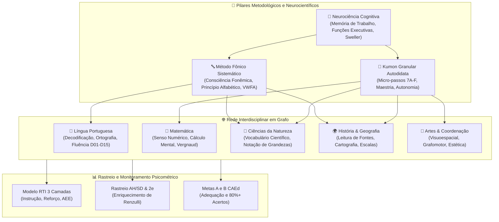

# SPEC-AIRAM-002: Arquitetura Metodológica Integrada — Método Fônico Sistemático, Kumon Granular Autodidata e Neurociência Cognitiva em Rede Interdisciplinar

> **Status**: Aprovado e Homologado (SDD / TDD)  
> **Data**: 2026-10-24  
> **Instituição**: Escola Municipal Airam Veras | Município de Crateús - Ceará | INEP: 23084995  
> **Versão**: 2.0.0-PROD  
> **Governança**: Criptográfica, Zero-PII e Auditável (Contraprova $\epsilon < 10^{-9}$)  

---

## 1. 🎯 Objetivos e Visão Geral

Este documento formaliza a arquitetura pedagógica e técnica do **Projeto Airam Veras**, integrando três pilares indissociáveis e validados pela literatura neurocientífica contemporânea:

1. **Método Fônico Sistemático e Explícito (Synthetic Phonics)**:
   - *Finalidade*: Alfabetização, precisão grafofonêmica, decodificação fonema-grafema, ortografia e fluência leitora automática.
   - *Fundamentação Neurocientífica*: Ativação da Área da Forma Visual das Palavras (*Visual Word Form Area* - VWFA) no giro fusiforme esquerdo e reciclagem neuronal (*Dehaene, 2012, DOI: 10.1093/acprof:oso/9780199753871.001.0001*); Fases de Desenvolvimento da Leitura (*Ehri, 2005, DOI: 10.1111/j.1467-9817.2005.00281.x*).
2. **Método Kumon Granular (Micro-passos & Autodidatismo)**:
   - *Finalidade*: Desenvolvimento do autodidatismo (*self-learning*), autonomia na resolução de tarefas, progressão granular sem saltos conceituais (*small-step progression*), domínio pleno de cálculo mental e velocidade motora/atencional.
   - *Fundamentação Cognitiva*: Teoria da Carga Cognitiva (*Sweller, 1988, DOI: 10.1207/s15516709cog1202_4*); Aprendizagem para a Maestria (*Bloom, 1968*); Prática Deliberada (*Ericsson, 1993, DOI: 10.1037/0033-295X.100.3.363*).
3. **Neurociência Cognitiva Aplicada**:
   - *Finalidade*: Otimização da retenção por repetição espaçada, consolidação mnemônica e gestão das funções executivas.
   - *Fundamentação Biológica*: Memória de Trabalho (*Baddeley, 2000, DOI: 10.1016/S1364-6613(00)01538-2*); Funções Executivas e Controle Inibitório (*Diamond, 2013, DOI: 10.1146/annurev-psych-113011-143750*); Campos Conceituais (*Vergnaud, 2009, DOI: 10.1016/j.humov.2009.04.004*).
4. **Rede Interdisciplinar e Multidisciplinar Conectada**:
   - Conexão em grafo de cada micro-nível de Kumon e Fônico aos 1.460 descritores CAEd e 574 habilidades da BNCC, perpassando Língua Portuguesa, Matemática, Ciências da Natureza, História, Geografia e Artes.

---

## 2. 🧬 Modelo Conceitual e Topologia em Grafo da Rede

---

## 3. 📋 Matriz de Níveis Granulares Kumon & Estágios Fônicos

### 3.1. Escala Granular do Kumon Integrada à BNCC e CAEd

| Nível Kumon | Faixa Cognitiva / Ano | Foco Operacional Granular | Tempo Padrão (SCT) | Descritores CAEd | Habilidades BNCC | Meta de Maestria |
|:---:|:---:|:---|:---:|:---:|:---|:---:|
| **7A – 5A** | Ed. Infantil / 1º Ano | Coordenação grafomotora fina, traçado de linhas e números 1 a 10. | 1 a 2 min / folha | D01_M | EF01MA01 | $100\%$ sem hesitação |
| **4A – 3A** | 1º Ano EF | Reconhecimento de numerais até 50 e contagem de pontos (subitização). | 2 a 3 min / folha | D02_M | EF01MA02 | $100\%$ sem contagem nos dedos |
| **2A – A** | 1º e 2º Ano EF | Adição básica ($+1$ a $+10$) e fatos fundamentais da soma; horizontal. | 3 a 4 min / folha | D03_M, D04_M | EF01MA06, EF02MA05 | $>95\%$ acertos no SCT |
| **B** | 2º e 3º Ano EF | Adição e subtração com reagrupamento vertical (2 a 3 dígitos). | 4 a 5 min / folha | D05_M, D06_M | EF02MA06, EF03MA05 | $>90\%$ acertos no SCT |
| **C** | 3º e 4º Ano EF | Tabuada elementar e multiplicação / divisão com restos (1 dígito). | 5 a 6 min / folha | D07_M, D08_M | EF03MA07, EF04MA04 | $>90\%$ acertos no SCT |
| **D** | 4º e 5º Ano EF | Multiplicação/divisão com múltiplos dígitos e introdução a frações. | 6 a 8 min / folha | D09_M, D10_M | EF04MA05, EF05MA08 | $>85\%$ acertos no SCT |
| **E – F** | 5º Ano / Transição | Operações com frações, decimais e problemas aritméticos compostos. | 8 a 10 min / folha | D11_M a D15_M | EF05MA02, EF05MA07 | $>85\%$ acertos no SCT |

### 3.2. Estágios do Método Fônico Sistemático (Fases de Ehri & Dehaene)

| Estágio Fônico | Fase de Ehri | Processo Neurocognitivo | Intervenção Didática Estruturada | Descritores CAEd | Habilidades BNCC |
|:---:|:---|:---|:---|:---:|:---|
| **E1: Consciência Fonológica** | Pré-Alfabética | Discriminação auditiva de rimas, aliterações e segmentação silábica. | Jogos orais com palmas, rimas sonoras e pareamento de sons iniciais. | D01_LP | EF01LP06 |
| **E2: Princípio Alfabético** | Alfabética Inicial | Mapeamento fonema $\leftrightarrow$ grafema explícito e sistemático (vogais e consoantes contínuas: /v/, /m/, /s/). | Fichas multissensoriais, escrita na areia, articulação labio-dental. | D02_LP | EF01LP02 |
| **E3: Decodificação Sintética** | Alfabética Plena | Síntese e fusão fonêmica (blending): $/s/ + /o/ + /l/ \rightarrow \text{sol}$; leitura de pseudopalavras. | Leitura assistida, cronômetro de decodificação e listas graduadas de palavras. | D03_LP | EF01LP08 |
| **E4: Leitura Ortográfica e Fluência** | Alfabética Consolidada | Acesso léxico direto via Área da Forma Visual das Palavras (VWFA); prosódia e velocidade. | Leitura repetida de textos autênticos, modelagem de entonação e pausas pontuais. | D04_LP, D05_LP | EF02LP04, EF03LP01 |

---

## 4. 📐 Contratos de Dados e Engenharia Relacional (SQLite)

O módulo introduz 5 tabelas relacionais em Terceira Forma Normal (3FN):

1. `dim_metodologias_aprendizagem`: Cadastro formal dos métodos pedagógicos ativos.
2. `dim_kumon_niveis_granulares`: Cadastro dos níveis de progressão, metas de tempo e pré-requisitos.
3. `dim_metodo_fonico_estagios`: Cadastro dos 4 estágios fônicos e ativação neurofuncional.
4. `rel_kumon_fonico_rede_interdisciplinar`: Matriz de arestas ponderadas conectando micro-passos Kumon/Fônico aos descritores CAEd e habilidades BNCC de 6 componentes curriculares.
5. `fato_trilha_aprendizagem_granular_aluno`: Rastreio nominal com hash seguro de cada aluno, nível atual, taxa de acerto diária e índice de autodidatismo.

---

## 5. 🧪 Especificação da Suíte de Testes TDD

Os testes em `datamining/tests/test_metodo_fonico_kumon_tdd.py` validam:
- **TDD-01**: Integridade referencial entre níveis Kumon, estágios Fônicos e descritores CAEd/BNCC.
- **TDD-02**: Critério de progressão estrita de Kumon: avanço para o nível seguinte requer taxa de acertos $\ge 90\%$ dentro do SCT (Standard Completion Time).
- **TDD-03**: Critério de decodificação fônica: alunos em estágio E3 devem alcançar taxa de leitura de palavras decodificáveis $\ge 80\%$.
- **TDD-04**: Validação da Rede Interdisciplinar: cada nível granular possui conexões com no mínimo 2 componentes curriculares distintos.
- **TDD-05**: Rastreio de Dupla Excepcionalidade (2e) e AH/SD: compactação curricular no Kumon sem pular a verificação de maestria.
- **TDD-06**: Validação Criptográfica: integridade de hashes SHA-256 em todas as trilhas individuais.
